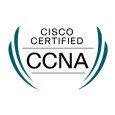

# Dominic Dudden

**Network Design · Implementation · Verification · Failure Testing · Troubleshooting**

I'm CCNA-certified and developing practical network engineering experience through Cisco Modeling Labs. My work focuses on resilient routing and switching, verification and troubleshooting.

Based in Northampton, UK, and seeking an early-career network engineering role.

<table width="100%">
  <tr>
    <td width="115" align="center" valign="middle">
      
    </td>
    <td valign="middle">
      <strong>Cisco Certified Network Associate (CCNA)</strong> 
      Issued by Cisco · September 2026 
      <a href="https://www.credly.com/badges/877c5523-1160-4fca-9dfb-0efba8a15a60/public_url">Verify on Credly</a>
    </td>
  </tr>
</table>

## [Multi-Site CML Home Lab](https://github.com/ddduddden/multi-site-cml-lab)

The five-device HQ campus runs OSPF Area 10, with VLAN segmentation, LACP, Rapid PVST+, HSRP, ECMP and deliberate OSPF cost engineering. Controlled failure testing records recovery behaviour, unexpected findings and design limitations.

**HQ V1 accepted — 26 October 2026.** Eleven documented engineering phases are complete, covering campus switching, gateway redundancy, OSPF routing, ECMP, controlled failure testing and final acceptance. The engineering records retain the observed results, unresolved findings and design limitations, which are documented in the final acceptance.

**GitHub is the source of truth** for the design, configurations, test evidence and version history.

**[View the repository](https://github.com/ddduddden/multi-site-cml-lab)** · [Interactive portfolio](https://dominicdudden.co.uk/)

[HQ design](https://github.com/ddduddden/multi-site-cml-lab/blob/main/docs/hq-campus-design.md) · [Verification](https://github.com/ddduddden/multi-site-cml-lab/blob/main/docs/implementation/hq/verification-plan.md) · [Failure testing](https://github.com/ddduddden/multi-site-cml-lab/blob/main/evidence/hq/failure-tests/README.md)

Planned development includes a Branch campus in Area 20, an Area 0 backbone, supporting network services and network automation.
